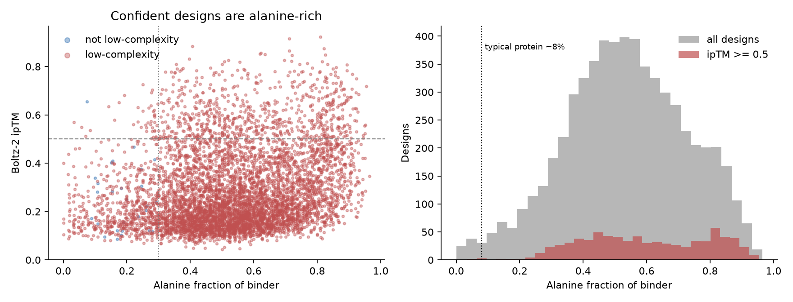
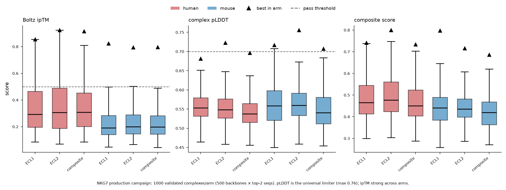

# De novo mini-binder design against NKG7 extracellular loops

[](https://github.com/Eomesodermin/nkg7-binder-design/actions/workflows/ci.yml)
[](LICENSE)

A config-driven, reusable pipeline for designing de novo mini-binders against a defined epitope
and validating them in silico, applied here to the two extracellular loops of **NKG7**, a
four-transmembrane granule protein of cytotoxic lymphocytes. The pipeline is not NKG7-specific:
point it at another target PDB and epitope residues and it regenerates the whole campaign.

**Pipeline:** RFdiffusion (backbones) → ProteinMPNN (sequences) → Boltz-2 (complex validation) →
Chai-1 (independent consensus) → cross-species re-fold → rank. An optional round of
partial-diffusion genetic-algorithm refinement follows.

## Aim

Existing NKG7 antibodies bind the intracellular C-terminus and cannot label intact cells. NKG7 has
only two short extracellular segments (ECL1, residues 30–60; ECL2, residues 113–132), so a
small binder to those loops would be a surface-accessible reagent. The question: **can a
computational pipeline produce credible mini-binders to two short, flexible, disulfide-free
loops, in both human and mouse?**

## Main findings

> The pipeline runs end to end at scale (6,000 validated complexes across six arms), but the
> in-silico evidence for a credible binder is weak. Three designs pass every Boltz-2 filter and one
> also passes the Chai-1 consensus, and an audit of the designed sequences shows that the confident
> designs are dominated by low-complexity, alanine-rich helices. **No design is both
> confident and sequence-diverse, so none is a candidate to take to the bench as it stands.**

| Funnel step (6 arms × 500 backbones × top-2 sequences) | Designs |
|-----|-------:|
| Complexes validated with Boltz-2 | 6,000 |
| Interface confident (ipTM ≥ 0.5) | 767 |
| Fold confident (complex pLDDT ≥ 0.7) | 12 |
| ipTM ≥ 0.5 **and** pLDDT ≥ 0.7 | 6 |
| Pass all Boltz-2 filters (ipTM, pLDDT, binder pTM, self-consistency RMSD) | 3 |
| Also pass the independent Chai-1 consensus | 1 |
| Predicted cross-reactive (confident against both human and mouse targets) | 22 |
| **Not low-complexity, ipTM ≥ 0.5** | **1** |
| **Not low-complexity, ipTM ≥ 0.5 and pLDDT ≥ 0.7** | **0** |

The limiting factor is fold quality, not the interface: many designs look like they bind, but
almost none fold confidently.



**Sequence-complexity audit.** The median designed binder is 53% alanine (58% among designs with
ipTM ≥ 0.5), against ~8% in typical proteins. Single-sequence co-folding gives high interface
scores to poly-alanine helices, so ipTM alone overstates quality here. Only 27 of the 6,000 designs
pass a deliberately permissive complexity filter, and none of those is both interface- and
fold-confident. The audit is reproducible with
[`pipeline/sequence_complexity.py`](pipeline/sequence_complexity.py) and tested in
[`tests/`](tests/).

**Pre-flight checks showed that single-fold scores are noisy.** Re-folding 24 production designs
at five diffusion samples gave a Spearman correlation of only 0.47 with the original ipTM. The
best human ECL2 design fell from ipTM 0.884 to 0.195, so it was largely a lucky fold. This led to
a funnel that screens cheaply and then re-folds a wide shortlist and ranks on the mean of five folds
(`filter_designs.py --aggregate mean`).

**Refinement did not rescue the designs.** A partial-diffusion genetic algorithm (an independent
re-implementation of Tan et al. 2026) with global elitism gained nothing over its seeds in any of
the four arms it ran on.



## What the pipeline does

```
target PDB + epitope residues + config.yaml
        │
        ▼
 loop-conformer ensemble (implicit MD; explicit-solvent MD and AlphaFlow as orthogonal checks)
        │
        ▼
 RFdiffusion ──► ProteinMPNN ──► Boltz-2 ──┬─► Chai-1 consensus ──┐
 (backbones)     (sequences)     (validate) └─► cross-species ─────┤
                                                                     ▼
                                          filter + rank ──► winners bundle (PDB + FASTA + scores)
                                                                     │
                                                partial-diffusion GA refinement (optional)
```

Design choices that shape the results (full rationale in
[`docs/DESIGN_DECISIONS.md`](docs/DESIGN_DECISIONS.md)):

- **Extracellular loops only.** TM and cytoplasmic epitopes are inaccessible on live cells.
- **Full-length target, interface restricted to loop hotspots.** The TM bundle acts as a steric
  wall so binders approach from the extracellular side only.
- **Three epitopes per species** (ECL1, ECL2, composite) to hedge on a hard target, and separate
  human and mouse campaigns with cross-reactivity tested afterwards. Loop conservation is
  moderate (ECL1 61%, ECL2 70% identical).
- **Loop flexibility is treated as a risk.** The loops have no disulfides. Independent MD
  replicas did not converge on one basin for three of the four loops (both ECL1s and human ECL2), which is why designing
  against a single AlphaFold conformer was judged insufficient.
- **Consensus over a single validator.** A design must pass Boltz-2 and an independent model
  (Chai-1) before it counts as a consensus hit.
- **Scoring.** `composite = 0.45·ipTM + 0.30·pLDDT + 0.15·binder pTM + 0.10·RMSD term`, with
  pass thresholds ipTM ≥ 0.5, pLDDT ≥ 0.7, binder pTM ≥ 0.5 and design-vs-refold RMSD ≤ 2 Å.

## Data and tools

| Resource | Used for |
|----------|----------|
| [UniProt](https://www.uniprot.org) Q16617 (human), Q99PA5 (mouse) | Target sequences |
| [AlphaFold DB](https://alphafold.ebi.ac.uk) models of both (`targets/`) | Target structures (no experimental structure exists) |
| RFdiffusion 1.1.0, ProteinMPNN (soluble model) | Backbone generation and sequence design |
| Boltz-2 2.2.1, Chai-1 0.6.1 | Complex validation and consensus |
| OpenMM 8.2, AlphaFlow | Loop-conformer ensembles |

All results here are computational. Raw run trees, MSAs and trajectories are not stored in the
repository; `results/` holds the ranked tables and summaries behind every number above.

## Assumptions and limitations

- Targets are AlphaFold models. The loops are flexible, and no experimental
  structure exists.
- Co-folding confidence (ipTM, pLDDT) is a proxy, not a binding free energy. Single-sequence
  validation (no MSA for the binder) is fast but favours simple helical sequences.
- The sequence-complexity thresholds (alanine ≤ 30%, entropy ≥ 3.2 bits, homopolymer ≤ 5) are
  heuristics, not calibrated cut-offs.
- Designs were not tested experimentally. No claim of binding is made.

**Obvious next steps:** bias or omit alanine in ProteinMPNN sampling and add a composition filter
before validation; validate with multiple diffusion samples from the start; try an MSA-based or
AF2-initial-guess validator for the shortlist; and test any survivors by experiment.

## Reproducing

```bash
pip install -r requirements.txt -r requirements-dev.txt
pytest                                    # unit tests for the complexity metrics

# regenerate the complexity audit from the committed ranked table
python pipeline/sequence_complexity.py \
    --designs results/production/production_all_arms_ranked.csv \
    --out-dir results/production --plot figures/sequence_complexity.png

# render the SLURM job scripts for a campaign (no cluster needed)
SLURM_ACCOUNT=my_account python pipeline/render_jobs.py \
    --config configs/nkg7_campaign.yaml --mode smoketest --ws /path/to/workspace --out rendered/
```

Running a campaign needs a SLURM GPU cluster and the conda environments in [`envs/`](envs/). See
[`docs/running_a_campaign.md`](docs/running_a_campaign.md) for the full walk-through and for the
cluster-specific settings (account, partitions, conda activation) to adapt.

## Repository layout

```
configs/    campaign definition (target, arms, parameters)
pipeline/   stage runners, job renderers, filtering, harvesting, GA refinement, complexity audit
envs/       conda environment specs
targets/    NKG7 human and mouse AlphaFold models, hotspots, loop exposure
results/    smoke-test, production, pre-flight and refinement tables; complexity audit
figures/    summary figures
docs/       design decisions, target biology and smoke test, GA refinement, running a campaign
tests/      unit tests
```

## Related

[`nkg7-structural-analysis`](https://github.com/Eomesodermin/nkg7-structural-analysis) is an
in-silico study of whether NKG7 forms an ion channel, using the same target.

## Citation

See [`CITATION.cff`](CITATION.cff). Released under the [MIT License](LICENSE).
