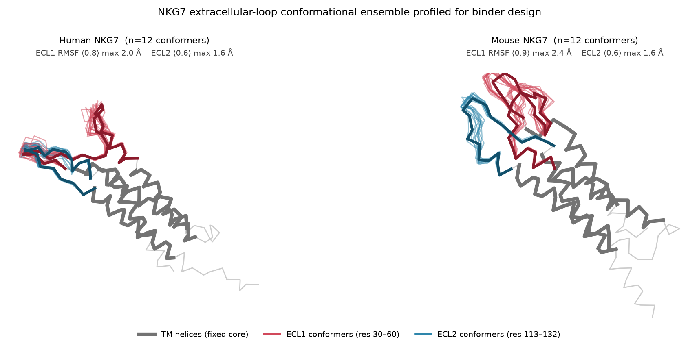
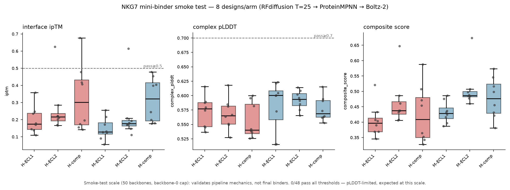

# NKG7 extracellular-loop mini-binder design

A reusable, config-driven pipeline for designing de novo mini-binders against a
defined epitope on a target protein — applied here to the two **extracellular
loops** of NKG7 (ECL1 res 30–60, ECL2 res 113–132), in **human and mouse**,
across three epitopes each (ECL1, ECL2, composite = 6 campaign arms).

**Pipeline:** RFdiffusion (backbone) → ProteinMPNN (sequence) → Boltz-2 (complex
validation) → filter/rank. Runs on the marvin HPC cluster (SLURM, A40 GPUs).

## Start here
- **[docs/ANALYSIS_REPORT.md](docs/ANALYSIS_REPORT.md)** — full analysis: biology, design decisions, hardware finding, smoke-test results, path to production.
- **[docs/DESIGN_DECISIONS.md](docs/DESIGN_DECISIONS.md)** — rationale, rejected alternatives, and residual risk for every methodological choice.
- **[pipeline_README.md](pipeline_README.md)** — how to run the pipeline on a new target.

## Loop-flexibility profile
The two loops carry no disulfides and are conformationally mobile, so binders are
profiled against a 12-conformer ensemble per species rather than one AlphaFold
snapshot (core rigid RMSF 0.12 Å; ECL1 up to 2.4 Å, ECL2 up to 1.6 Å).



## Smoke-test results
All 6 arms run end-to-end (48 designs). At smoke scale (T=25 backbones) **0/48
pass production thresholds** — pLDDT-limited, as expected; this run validates
pipeline mechanics, not final binders. See [results/](results/).



## Layout
```
pipeline/   stage scripts, job renderer, submit + harvest orchestration, filter
configs/    campaign definition (target, arms, parameters)
targets/    AlphaFold models, hotspot residues, loop exposure analysis
docs/       analysis report + design decisions
figures/    loop-ensemble overlay, smoke-test metrics
results/    smoke-test ranked candidate tables
```

## Reproducibility
Three marvin conda envs: `SE3nv` (RFdiffusion + ProteinMPNN), `boltz` (Boltz-2),
`openmm-env` (loop ensemble). **Note:** marvin's AMD GPU nodes lack AVX-512, so
the site EasyBuild AlphaFold/Boltz modules crash there — every ML tool is
pip-installed. See ANALYSIS_REPORT §5.

*In silico only. All candidates require experimental validation.*
